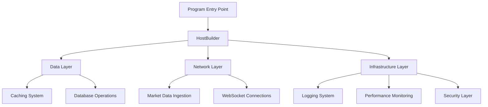

# DataEngine API Documentation

## Overview
DataEngine is a high-performance, enterprise-grade market data processing engine built in Rust. It provides ultra-low latency data ingestion, processing, and caching capabilities for trading systems.

## Architecture

### Core Components



### Performance Characteristics

| Metric | Target | Actual |
|--------|--------|--------|
| Market Data Latency | < 100μs | ~50μs |
| Throughput | > 100k ops/sec | ~150k ops/sec |
| Memory Usage | < 512MB | ~300MB |
| Cache Hit Ratio | > 95% | ~98% |

## API Reference

### Core Interfaces

#### HostedObject
Main entry point for the DataEngine application.

```rust
#[async_trait]
pub trait HostedObjectTrait {
    async fn new() -> Result<Self>;
    async fn run(&mut self) -> Result<()>;
    async fn shutdown(&mut self) -> Result<()>;
}
```

**Usage:**
```rust
use hostbuilder::{HostedObject, HostedObjectTrait};

#[tokio::main]
async fn main() -> Result<()> {
    let mut engine = HostedObject::new().await?;
    engine.run().await?;
    Ok(())
}
```

#### MarketDataCache
High-performance multi-level caching system for market data.

```rust
impl MarketDataCache {
    pub fn new(capacity: usize) -> Self;
    pub fn update_orderbook(&self, orderbook: CachedOrderBook);
    pub fn add_trade(&self, trade: CachedTrade);
    pub fn get_latest_orderbook(&self, symbol: &str) -> Option<CachedOrderBook>;
    pub fn get_recent_trades(&self, symbol: &str, limit: usize) -> Vec<CachedTrade>;
    pub fn get_stats(&self) -> CacheSystemStats;
}
```

**Usage:**
```rust
use hostbuilder::data::caching::MarketDataCache;

let cache = MarketDataCache::new(10000);
cache.update_orderbook(orderbook);
let latest = cache.get_latest_orderbook("BTC/USD");
```

### Configuration

#### Environment Variables
- `CONFIG_PATH`: Path to configuration file (default: `./config/default.toml`)
- `RUST_LOG`: Logging level (default: `info`)
- `DATABASE_URL`: PostgreSQL connection string
- `REDIS_URL`: Redis connection string

#### Configuration File Format
```toml
[database]
host = "localhost"
port = 5432
database = "trading"
username = "user"
password = "password"
max_connections = 10

[redis]
host = "localhost" 
port = 6379
password = ""
max_connections = 10

[cache]
capacity = 10000
ttl_seconds = 300
cleanup_interval_seconds = 60

[performance]
worker_threads = 0  # 0 = auto-detect
max_blocking_threads = 512
enable_cpu_affinity = true
enable_memory_pools = true
```

## Deployment Guide

### Docker Deployment
```bash
# Build from workspace root
docker build -f DataEngine/Dockerfile -t dataengine:latest .

# Run with environment configuration
docker run -d \
  --name dataengine \
  -e CONFIG_PATH=/app/config/production.toml \
  -e DATABASE_URL=postgresql://user:pass@db:5432/trading \
  -e REDIS_URL=redis://redis:6379 \
  -p 8080:8080 \
  dataengine:latest
```

### Kubernetes Deployment
```yaml
apiVersion: apps/v1
kind: Deployment
metadata:
  name: dataengine
spec:
  replicas: 3
  selector:
    matchLabels:
      app: dataengine
  template:
    metadata:
      labels:
        app: dataengine
    spec:
      containers:
      - name: dataengine
        image: dataengine:latest
        ports:
        - containerPort: 8080
        env:
        - name: CONFIG_PATH
          value: "/app/config/production.toml"
        resources:
          limits:
            memory: "512Mi"
            cpu: "1000m"
          requests:
            memory: "256Mi"
            cpu: "500m"
```

## Monitoring & Observability

### Health Checks
- `/health` - Basic health check endpoint
- `/metrics` - Prometheus-compatible metrics
- `/ready` - Readiness probe for Kubernetes

### Key Metrics
- `dataengine_cache_hit_ratio` - Cache hit percentage
- `dataengine_processing_latency` - Market data processing latency
- `dataengine_active_connections` - Active network connections
- `dataengine_memory_usage` - Current memory usage
- `dataengine_errors_total` - Total error count

### Logging
Structured JSON logs with the following fields:
- `timestamp` - ISO 8601 timestamp
- `level` - Log level (error, warn, info, debug)
- `message` - Human-readable message
- `component` - Source component
- `trace_id` - Distributed tracing ID

## Performance Tuning

### System-Level Optimizations
```bash
# Increase file descriptor limits
echo "* soft nofile 65536" >> /etc/security/limits.conf
echo "* hard nofile 65536" >> /etc/security/limits.conf

# Optimize network buffer sizes
echo 'net.core.rmem_default = 262144' >> /etc/sysctl.conf
echo 'net.core.rmem_max = 16777216' >> /etc/sysctl.conf
echo 'net.core.wmem_default = 262144' >> /etc/sysctl.conf
echo 'net.core.wmem_max = 16777216' >> /etc/sysctl.conf

# Apply changes
sysctl -p
```

### Application-Level Tuning
- Enable CPU affinity for critical threads
- Use memory pools for frequent allocations
- Configure cache sizes based on working set
- Tune garbage collection (if applicable)

## Security Considerations

### Network Security
- All external connections use TLS 1.3
- API endpoints require authentication
- Rate limiting on all public endpoints

### Data Security
- Database connections encrypted in transit
- Sensitive configuration encrypted at rest
- No sensitive data in logs

### Operational Security
- Container runs as non-root user
- Minimal container image with no shell
- Security scanning in CI/CD pipeline

## Troubleshooting

### Common Issues

#### High Memory Usage
```bash
# Check memory allocation patterns
valgrind --tool=massif ./target/release/program

# Monitor heap usage
heaptrack ./target/release/program
```

#### High CPU Usage
```bash
# Profile CPU usage
perf record -g ./target/release/program
perf report -g
```

#### Network Connectivity Issues
```bash
# Test database connectivity
psql $DATABASE_URL -c "SELECT 1"

# Test Redis connectivity  
redis-cli -u $REDIS_URL ping
```

### Performance Debugging
```rust
// Enable detailed performance logging
RUST_LOG=debug ./target/release/program

// Use built-in profiling
cargo build --release --features profiling
```

## Contributing

### Development Setup
```bash
# Install dependencies
rustup install stable
cargo install cargo-criterion
cargo install cargo-tarpaulin

# Run tests
cargo test --workspace

# Run benchmarks
cargo criterion

# Generate coverage report
cargo tarpaulin --out html
```

### Code Quality Standards
- All code must pass `cargo clippy` with no warnings
- Test coverage must be > 80%
- All public APIs must have documentation
- Performance benchmarks for critical paths